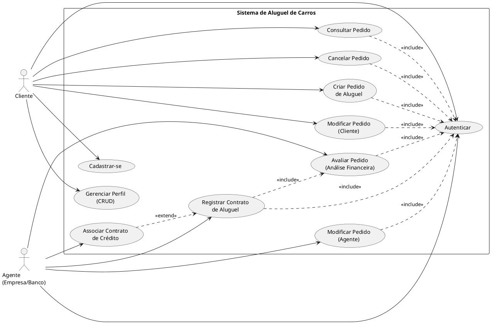

# Casos de Uso — Sistema de Aluguel de Carros

## Atores

| Ator | Descrição |
|------|-----------|
| **Cliente** | Pessoa física que solicita aluguéis de automóveis |
| **Agente** | Empresa ou banco que analisa e aprova pedidos de aluguel |

## Diagrama

## Descrição dos Casos de Uso

| ID | Caso de Uso | Ator Principal | Descrição |
|----|-------------|----------------|-----------|
| UC01 | Cadastrar-se | Cliente | Cria conta informando dados pessoais (RG, CPF, nome, endereço, profissão, rendimentos) |
| UC02 | Autenticar | Cliente / Agente | Login com usuário e senha |
| UC03 | Gerenciar Perfil | Cliente | Visualiza, edita e exclui seus dados cadastrais e rendimentos |
| UC04 | Criar Pedido de Aluguel | Cliente | Abre novo pedido selecionando automóvel e período desejado |
| UC05 | Modificar Pedido (Cliente) | Cliente | Altera dados do pedido enquanto em status EM_ANALISE |
| UC06 | Consultar Pedido | Cliente | Lista e detalha seus pedidos de aluguel |
| UC07 | Cancelar Pedido | Cliente | Cancela pedido com status EM_ANALISE ou APROVADO |
| UC08 | Avaliar Pedido | Agente | Realiza análise financeira e emite parecer (APROVADO / REPROVADO) |
| UC09 | Modificar Pedido (Agente) | Agente | Ajusta condições do pedido durante a análise |
| UC10 | Registrar Contrato de Aluguel | Agente | Formaliza contrato após aprovação do pedido |
| UC11 | Associar Contrato de Crédito | Agente (Banco) | Vincula financiamento bancário ao contrato de aluguel |
