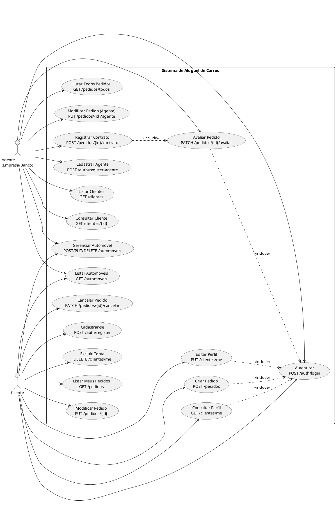

# Casos de Uso — Sistema de Aluguel de Carros

> Arquivo fonte: [`/docs/diagramas/casos-de-uso.puml`](diagramas/casos-de-uso.puml)

## Atores

| Ator | Descrição |
|------|-----------|
| **Cliente** | Pessoa física que solicita aluguéis de automóveis |
| **Agente** | Empresa ou banco que analisa e aprova pedidos de aluguel |

## Diagrama

## Descrição dos Casos de Uso

| ID | Endpoint | Método | Role | Descrição |
|----|----------|--------|------|-----------|
| UC01 | `/api/auth/register` | POST | público | Cadastro de cliente com dados pessoais e credenciais |
| UC02 | `/api/auth/register-agente` | POST | público | Cadastro de agente (empresa ou banco) |
| UC03 | `/api/auth/login` | POST | público | Login — retorna JWT + role |
| UC04 | `/api/clientes/me` | GET | CLIENTE | Consulta próprio perfil |
| UC05 | `/api/clientes/me` | PUT | CLIENTE | Atualiza nome, endereço, profissão e rendimentos |
| UC06 | `/api/clientes/me` | DELETE | CLIENTE | Exclui conta e usuário vinculado |
| UC07 | `/api/clientes` | GET | AGENTE | Lista todos os clientes cadastrados |
| UC08 | `/api/clientes/{id}` | GET | AGENTE | Consulta cliente por ID |
| UC09 | `/api/automoveis` | GET | autenticado | Lista automóveis disponíveis |
| UC10 | `/api/automoveis` | POST/PUT/DELETE | AGENTE ou CLIENTE proprietário | CRUD de automóveis |
| UC11 | `/api/pedidos` | POST | CLIENTE | Cria pedido com status EM_ANALISE |
| UC12 | `/api/pedidos` | GET | CLIENTE | Lista pedidos do cliente logado |
| UC13 | `/api/pedidos/{id}` | PUT | CLIENTE | Modifica pedido (apenas EM_ANALISE) |
| UC14 | `/api/pedidos/{id}/cancelar` | PATCH | CLIENTE | Cancela pedido (EM_ANALISE ou APROVADO) |
| UC15 | `/api/pedidos/todos` | GET | AGENTE | Lista todos os pedidos do sistema |
| UC16 | `/api/pedidos/{id}/agente` | PUT | AGENTE | Modifica condições do pedido durante análise |
| UC17 | `/api/pedidos/{id}/avaliar` | PATCH | AGENTE | Emite parecer APROVADO ou REPROVADO com justificativa |
| UC18 | `/api/pedidos/{id}/contrato` | POST | AGENTE | Registra contrato de aluguel (status → CONTRATADO) com crédito opcional |
